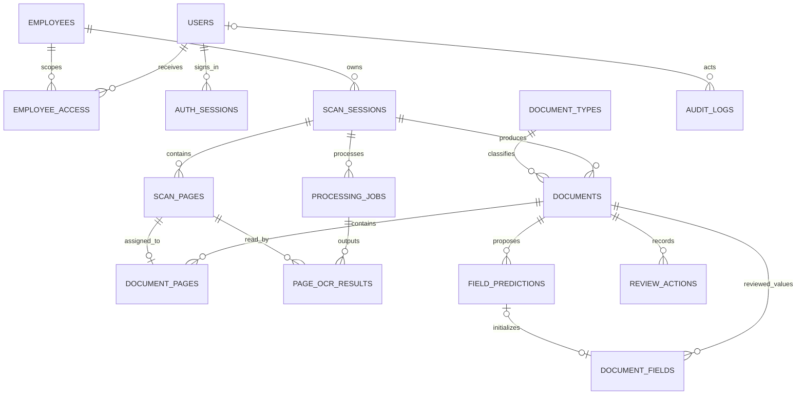

# Database Docentra MVP

Nguồn định nghĩa bảng là các class ORM trong `app/model`, dùng PostgreSQL và SQLAlchemy. Thiết kế theo PRD trong chat [docentra](https://chatgpt.com/c/6ae2ccc6-c7a4-83ec-82ac-8fb6e9337700), phạm vi MVP 21 ngày với dữ liệu giả.

## Quy ước code

Tham khảo trực tiếp `P-029/src/models`, `src/db/base.py`, `src/db/base_model.py` và `src/models/timestamp.py` trên máy:

- Mỗi bảng một file tên số nhiều, class số ít; `__tablename__`, `Column`, FK, constraint và index khai báo trong ORM.
- Dùng chung `Base` từ `app.db.base`; `TimestampMixin` gom `created_at/updated_at` cho bảng có sửa đổi.
- UUID, JSONB và TSVECTOR theo PostgreSQL; trạng thái viết hoa, mã loại tài liệu viết thường.
- Quan hệ được khai báo bằng FK, giống P-029; chưa cần thêm `relationship()` khi chưa có nhu cầu truy vấn qua thuộc tính.
- `app/model` chỉ chứa định nghĩa bảng. Query, auth, nghiệp vụ, upload, pipeline và kiểm tra điều kiện duyệt thuộc các phần triển khai tiếp theo.
- Dùng timestamp có timezone. `AuditLog.audit_metadata` ánh xạ cột `metadata` để tránh xung đột với `Base.metadata`.

Hook đăng ký đầy đủ 15 bảng:

```python
from app.db.base_model import Base

target_metadata = Base.metadata
```

Import model không kết nối DB hoặc tự tạo bảng. Alembic đã cấu hình trong `alembic/`; `env.py` đọc URL từ `app.db.config` và dùng metadata ở trên. Engine/session API ở `app/db/session.py`, auth controller ở `app/api/auth.py`; business logic không đặt trong ORM.

## PostgreSQL Docker và Alembic

PostgreSQL 17 chạy trong Compose project `docentra`, service `db`, container mặc định `docentra-db-1`. Kết nối từ máy host: `127.0.0.1:5433`, database/user `docentra`. Mật khẩu nằm trong `.env` bị Git ignore; `.env.example` là mẫu cấu hình. Volume `docentra_postgres_data` giữ dữ liệu khi container dừng.

Chạy các lệnh từ thư mục gốc Docentra, dùng venv Python của dự án:

```bash
venv/bin/python -m pip install -r requirements.txt
docker compose up -d --wait db
venv/bin/alembic upgrade head
venv/bin/alembic current
venv/bin/alembic check
```

Máy mới cần tạo `.env` từ `.env.example` và đặt mật khẩu trước khi chạy Compose. `DATABASE_URL`, nếu có, ưu tiên hơn các biến `POSTGRES_*` cho Alembic; Compose vẫn dùng `POSTGRES_*`. Khi API chạy trong container cùng network, dùng hostname `db`, cổng `5432`; cấu hình hiện tại dành cho chạy Alembic/API trên máy host.

Migration `0001` tạo 14 bảng và constraint/index; `0002` seed 4 loại giấy tờ ban đầu; `0003` thêm `auth_sessions`; `0004` thêm trigger giữ bất biến ảnh gốc/lịch sử và chặn sửa nội dung verified/rejected khi chưa reopen. Tài khoản và nhân viên synthetic được seed bằng `app.seed`, không nằm trong schema migration. Không tạo tài khoản hay hồ sơ nhân viên thật. Migration là snapshot độc lập, không gọi `Base.metadata.create_all()` và không import model runtime để định nghĩa lại bảng cũ.

Sau khi sửa model, sinh và đọc lại migration trước khi áp dụng:

```bash
venv/bin/alembic revision --autogenerate -m "describe_schema_change"
venv/bin/alembic upgrade head
venv/bin/alembic check
```

Dừng DB bằng `docker compose stop db`; chạy lại bằng `docker compose up -d --wait db`. Giữ volume để bảo toàn dữ liệu. Thay password trong `.env` không tự đổi password của PostgreSQL đã khởi tạo trong volume.

## Các bảng và quan hệ

| Nhóm | Bảng | Vai trò |
| --- | --- | --- |
| Danh tính và phạm vi | `users`, `employees`, `employee_access` | User sử dụng hệ thống khác với nhân viên có hồ sơ; cấp quyền capture/review/view theo employee |
| Phiên đăng nhập | `auth_sessions` | Hash token ngẫu nhiên và CSRF, user, expiry/revoke; cookie auth HttpOnly |
| Capture | `scan_sessions`, `scan_pages` | Một session của một employee; ảnh gốc có object key, hash, thứ tự, mã chống upload trùng |
| Tài liệu | `document_types`, `documents`, `document_pages` | Một session có nhiều giấy tờ, mỗi giấy tờ có nhiều trang; thứ tự tài liệu riêng với thứ tự capture |
| Xử lý AI | `processing_jobs`, `page_ocr_results`, `field_predictions` | Theo dõi job, retry/lease, OCR từng trang và đề xuất từng trường theo lần xử lý |
| Xác minh và truy vết | `document_fields`, `review_actions`, `audit_logs` | Giá trị HR đang kiểm tra/đã duyệt, lịch sử thay đổi, audit hoạt động |



`documents` lấy employee qua session, không lưu lặp `employee_id`. Chưa cần bảng dossiers vì hồ sơ nhân viên là tập các tài liệu đã số hóa qua nhiều session.

FK tổ hợp giữ document/page/job cùng session. Một scan page chỉ thuộc tối đa một document. Nguồn của `document_fields` phải là trang thuộc document đó; prediction tham chiếu phải đúng cả document và tên trường. Prediction lịch sử chỉ cần nguồn cùng session để không mất bằng chứng khi HR phân nhóm lại.

## Danh mục P0 được seed bởi migration 0002

| `DocumentType.code` | Trường gợi ý trong `field_schema` |
| --- | --- |
| `unknown` | Chưa phân loại; không được duyệt |
| `employment_contract` | `contract_number`, `contract_type`, `signed_date`, `effective_date` |
| `degree` | `degree_name`, `major`, `issuer`, `issue_date` |
| `practice_certificate` | `certificate_number`, `certificate_type`, `issue_date`, `issuer` |

`field_schema` là object JSON, ví dụ `{"signed_date": {"type": "date", "required": true}}`. Trường bắt buộc và nhãn hiển thị cần HR xác nhận. Ngày tài liệu chuẩn hóa `YYYY-MM-DD`; giá trị HR có tối đa 500 ký tự trong MVP, khác với OCR thô lưu bằng `Text`.

## Các quy tắc cần giữ khi viết nghiệp vụ

- Session: `UPLOADING → UPLOADED → PROCESSING → NEEDS_REVIEW → COMPLETED`, có `FAILED/CANCELLED` cho lỗi và hủy. Document: `DRAFT → NEEDS_REVIEW → VERIFIED/REJECTED`.
- Mã client/session/page/job chống retry trùng. Unique active job/session chặn hai job `QUEUED/RUNNING` cùng phiên. Backend phải kiểm cùng ID nhưng khác hash/body và dùng token lease khi worker commit.
- Chỉ insert page sau khi upload private storage và kiểm checksum thành công. Finalize phải kiểm tập ID/hash/thứ tự/đủ số trang và freeze capture trong transaction. Object storage không cùng transaction với DB nên cần receipt và dọn orphan có kiểm soát.
- `field_predictions` giữ nguyên output AI; `document_fields` chứa bản HR sửa. Chạy lại giữ job/output cũ và chọn output hiện tại qua `documents.latest_job_id`. Chấm AI trên prediction trước review, không trên giá trị HR đã sửa.
- `PRESENT`, `NOT_FOUND`, `UNREADABLE`, `NOT_APPLICABLE` phân biệt giá trị có/thiếu/không đọc được/không áp dụng. Confidence không tự cấp quyền duyệt. Bbox là `[x0,y0,x1,y1]` 0–1 trên ảnh gốc; API kiểm kiểu và miền tọa độ.
- Duyệt phải kiểm mọi trường cần thiết, nguồn đúng document, OCR đủ trang, manifest còn khớp, đúng chủ thể employee và reviewer có grant. `VERIFIED` mới vào search thông thường.
- Sửa bản verified phải reopen, xóa mốc duyệt, tăng version và ghi history trong cùng transaction. Services lock document và kiểm `version` trước ghi; stale request trả 409.
- User role giới hạn nhóm chức năng; `employee_access` giới hạn hồ sơ được thao tác. Admin không mặc định đọc ảnh. API phải kiểm trạng thái user, role và grant ở mỗi request.
- Ảnh gốc/ảnh xử lý lưu private storage, DB chỉ lưu key. Không trả public URL. Audit thông thường chỉ ghi ID/action/outcome; lịch sử old/new nhạy cảm nằm ở `review_actions.changes` với quyền reviewer.
- OCR full-text dùng cấu hình `simple` và GIN. Query phải lọc `VERIFIED`, quyền employee và job đang được chấp nhận; chưa có tìm không dấu/ngữ nghĩa.

Model hiện thực FK, unique, CHECK và index. Services đã thực thi các điều kiện nhiều bảng cho finalize/grouping/verify, nguồn, typed date, quyền, version và trạng thái. Migration `0004` bổ sung bảo vệ ảnh/lịch sử/nội dung approved ở DB. Worker claim/reap/heartbeat có lease fencing; output OCR/prediction publish atomically và không bị HR ghi đè. Các tác vụ purge/retention, sửa grouping sau xử lý và schema version bất biến vẫn là phần mở rộng sau MVP.

Không có cascade xóa hàng loạt dữ liệu hồ sơ trong baseline. User có thể soft-delete; audit actor cho phép null khi xóa vật lý user. Xóa ảnh/metadata/history/backup cần quy trình retention riêng trước pilot.
